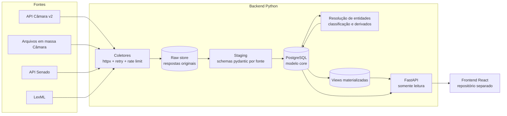
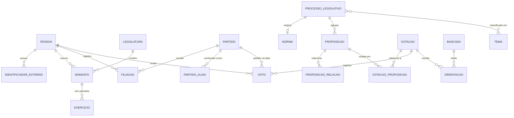
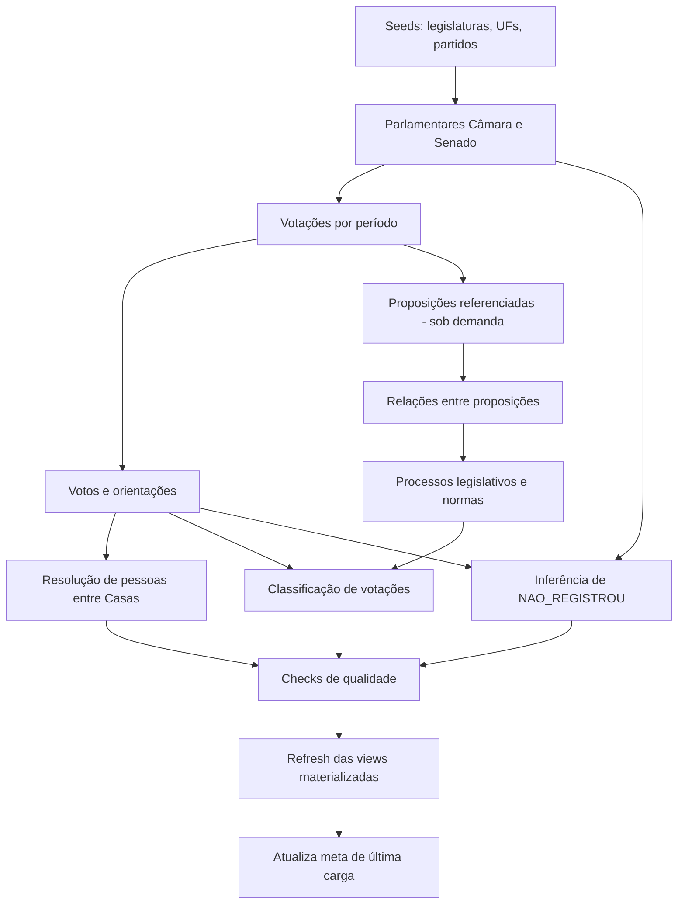

# VotosBR — Documento Base do Projeto

> Plataforma para consulta de como deputados federais e senadores votaram em leis e proposições.
> Este documento é a referência para as tarefas executadas por assistentes de IA no **backend Python**.
> O frontend React é um projeto separado e consome a API descrita na seção 7.
>
> Versão 0.2 · novembro/2026 · "VotosBR" é um nome provisório.
> Mudanças da 0.2: carga incremental a partir de 2026-11-01 com checkpoint e janela de revisão de 7 dias, sempre cobrindo o dia anterior (seção 6.2.1); backfill histórico passa a ser etapa posterior.

---

## 0. Como usar este documento

### 0.1 Para o assistente de IA

1. Antes de escrever código, leia esta seção, o glossário e as armadilhas (seção 2) e a seção específica da tarefa.
2. Este documento descreve **o quê** e **o porquê**. Se a implementação precisar divergir, atualize o documento na mesma tarefa e registre a decisão na seção 13.
3. Endpoints e nomes de campos das fontes listados aqui são **ponto de partida, não verdade absoluta**. As APIs públicas mudam. Antes de implementar qualquer cliente: faça uma chamada real, salve a resposta como fixture em `tests/fixtures/<fonte>/` e derive os schemas a partir dela. **Nunca invente campos.**
4. Ao encontrar um valor que não está mapeado (tipo de voto, sigla, situação), registre-o e siga em frente. Nunca derrube uma carga inteira por causa de um registro.

### 0.2 Regras gerais (em ordem de prioridade)

1. **Fidelidade à fonte oficial.** Nunca alterar o voto registrado. Guardar sempre o valor original ao lado do valor normalizado.
2. **Rastreabilidade.** Todo dado exibido aponta para a URL oficial de origem e para a data de coleta.
3. **Neutralidade.** O sistema não qualifica votos como bons ou ruins. Toda métrica tem definição pública (seção 7.4).
4. **Idempotência.** Qualquer job pode ser executado de novo sem duplicar nem corromper dados.
5. **Tolerância a falhas parciais.** Registro inválido vai para log/tabela de pendências; o restante da carga continua.
6. **Reprocessabilidade.** Toda resposta bruta é guardada; é possível reconstruir o banco sem chamar as APIs de novo.

### 0.3 Template de tarefa

```markdown
## Tarefa T-XXX — <título>
**Contexto:** seções <x.y> deste documento
**Objetivo:** <uma frase>
**Entradas:** <fontes, tabelas, arquivos>
**Saídas esperadas:** <tabelas, endpoints, arquivos>
**Critérios de aceite:**
- [ ] testes unitários/integrados cobrindo ...
- [ ] rodar duas vezes não altera contagens
- [ ] ruff e mypy sem erros
- [ ] documento atualizado se o modelo ou contrato mudou
**Fora de escopo:** <o que não fazer>
```

---

## 1. Visão geral

### 1.1 Objetivo

Permitir que qualquer pessoa descubra, de forma rápida e verificável, como cada deputado federal e cada senador votou em uma lei ou proposição, e consulte o histórico de votos de cada parlamentar.

### 1.2 Escopo do MVP

- Casas: Câmara dos Deputados e Senado Federal, votações em **Plenário**.
- Votações nominais com votos individuais e orientações de bancada.
- Votações simbólicas e secretas registradas como tais (sem inventar votos individuais).
- Agrupamento das proposições das duas Casas em um **processo legislativo**, ligado à **norma** (lei) resultante quando houver.
- Inclusão de projetos ainda em tramitação (não só leis já publicadas).
- API REST somente leitura consumida pelo frontend React.

### 1.3 Fora do escopo do MVP

Votações em comissões; sessões conjuntas do Congresso (vetos, PLN); assembleias estaduais e câmaras municipais; contas de usuário, alertas e comentários. Ver roadmap (seção 10).

---

## 2. Conceitos do domínio

### 2.1 Glossário

| Termo | Significado | Impacto no sistema |
|---|---|---|
| Proposição / Matéria / Processo | Documento em tramitação (PL, PEC, MPV...). A Câmara usa "proposição"; o Senado usa "matéria" e, nas APIs mais novas, "processo". | Tabela `proposicao`, uma linha por Casa. |
| Norma jurídica | Resultado publicado, ex.: Lei nº 12.965/2014. | Tabela `norma`. É o que o usuário chama de "lei". |
| Processo legislativo | Conceito do VotosBR: agrupa as proposições das duas Casas que tratam do mesmo projeto e a norma resultante. | Tabela `processo_legislativo`; é a "página da lei" na UI. |
| PL / PLP / PEC | Projeto de Lei / de Lei Complementar / Proposta de Emenda à Constituição. | `sigla_tipo`. PEC tem dois turnos em cada Casa. |
| MPV / PLV | Medida Provisória / Projeto de Lei de Conversão (texto da MP alterado pelo Congresso). | MPV e PLV ficam no mesmo processo. |
| PDL | Projeto de Decreto Legislativo. | `sigla_tipo`. |
| Casa iniciadora / revisora | Onde o projeto começou / para onde foi depois. | Linha do tempo do processo. |
| Votação nominal | Cada parlamentar registra o voto no painel. | Única modalidade com votos individuais com sentido. |
| Votação simbólica | O presidente verifica o plenário sem registro individual. | **Não existem votos individuais.** A UI precisa dizer isso claramente. |
| Votação secreta | Registra-se quem votou, mas não o sentido. | Voto `SECRETO`. |
| Texto-base, substitutivo | Texto principal votado. | Candidato a "votação principal". |
| Emenda, destaque, DVS | Votações de partes do texto. | Votações secundárias do mesmo processo. |
| Requerimento | Votações procedimentais (urgência, adiamento, retirada de pauta). | Exibidas, mas não como "a" votação da lei. |
| Redação final | Votação da redação consolidada. | Classificação própria. |
| Orientação de bancada | Recomendação de voto do líder de partido, bloco, federação, Governo, Oposição, Maioria ou Minoria. | Tabela `orientacao`; base das métricas de alinhamento. |
| Obstrução | Estratégia regimental para impedir quórum; na Câmara é registrada como voto. | Voto `OBSTRUCAO`. |
| Legislatura | Período de 4 anos; a 57ª vai de 01/02/2023 a 31/01/2027. | Tabela `legislatura`. |
| Mandato / exercício | Mandato é o direito à cadeira; exercício é estar efetivamente atuando (pode haver licença). Senadores têm mandato de 8 anos (duas legislaturas). | Tabelas `mandato` e `exercicio`. |
| Titular / suplente | O suplente assume a cadeira quando o titular se afasta. | Uma cadeira pode ter várias pessoas na mesma legislatura. |
| Federação partidária | União de partidos que atuam como uma bancada (desde 2022). | Tabela `bancada`. |

### 2.2 Armadilhas conhecidas (ler antes de modelar)

1. **Lei ≠ proposição ≠ votação.** Uma lei resulta de um processo com ao menos uma proposição por Casa, e cada proposição pode ter dezenas de votações (urgência, texto-base, destaques, redação final).
2. **Numeração entre Casas.** Até 2018, um PL da Câmara recebia outro número no Senado. Exemplo: PL 2.126/2011 (Câmara) virou PLC 21/2014 (Senado) e resultou na Lei 12.965/2014 (Marco Civil da Internet). A partir de 2019 a numeração de PLs passou a ser mantida entre as Casas. **Validar o comportamento para cada tipo** (PEC e outros podem ter regras próprias).
3. **A Câmara só lista quem registrou voto.** Quem não votou não aparece em `/votacoes/{id}/votos`. O "não registrou voto" precisa ser inferido a partir de quem estava em exercício (seção 6.7) e marcado como dado derivado. Isso **não** é o mesmo que ausência: o deputado pode estar presente e não votar.
4. **O Senado registra ausências e seus motivos** (licença, missão, atividade parlamentar etc.) com siglas próprias.
5. **Partidos mudam.** Parlamentares trocam de partido (janela partidária); partidos mudam de nome, se fundem ou são incorporados (ex.: PMDB → MDB; PR → PL; DEM + PSL → União Brasil; PTB + Patriota → PRD). A mesma sigla pode designar partidos diferentes em épocas diferentes (o "PL" anterior a 2006 não é o "PL" atual). Por isso **o voto guarda o partido e a UF do momento da votação**.
6. **Mesma pessoa, IDs diferentes.** Um deputado que vira senador tem um ID na Câmara e outro no Senado.
7. **Presidente da Casa.** Na Câmara aparece como "Artigo 17" (não vota, salvo desempate); no Senado, como "Presidente (art. 51 RISF)".
8. **Correções posteriores.** Votações e votos podem ser corrigidos na fonte depois de publicados. A carga incremental precisa revisitar uma janela recente.
9. **Datas e fuso.** Algumas fontes trazem horário de Brasília sem fuso explícito. Armazenar `timestamptz`, convertendo a partir de `America/Sao_Paulo`.
10. **Grande parte das leis tem ao menos uma votação simbólica.** O produto precisa comunicar isso bem; não é falha do sistema.

---

## 3. Fontes de dados

> ⚠️ **Status:** lista montada com conhecimento até meados de 2026. Validar cada endpoint na documentação oficial (Swagger) antes de implementar. O Senado, em particular, vem migrando endpoints antigos para novos.

### 3.1 Câmara dos Deputados — Dados Abertos (fonte primária)

- API REST v2: `https://dadosabertos.camara.leg.br/api/v2`
- Documentação (Swagger): `https://dadosabertos.camara.leg.br/swagger/api.html`
- Arquivos em massa: `https://dadosabertos.camara.leg.br/swagger/arquivos.html`
- Formatos: JSON (header `Accept: application/json`) e XML.
- Paginação: parâmetros `pagina` e `itens` (máx. 100); a resposta traz `links` com `rel="next"`.

| Endpoint | Uso | Observações |
|---|---|---|
| `GET /deputados` | Lista de deputados (filtros `idLegislatura`, `siglaUf`, `siglaPartido`, `nome`) | Sem `idLegislatura`, tende a retornar só quem está em exercício. |
| `GET /deputados/{id}` | Detalhes: nome civil, nascimento, foto, `ultimoStatus` | Traz CPF: **não armazenar em claro** (seção 5.3). |
| `GET /deputados/{id}/historico` | Mudanças de partido, situação e condição | Base para `filiacao`, `mandato` e `exercicio`. |
| `GET /legislaturas` | Períodos das legislaturas | Seed. |
| `GET /partidos`, `GET /partidos/{id}` | Partidos | Conferir siglas históricas. |
| `GET /proposicoes` | Busca por `siglaTipo`, `numero`, `ano`, datas, palavras-chave | |
| `GET /proposicoes/{id}` | Ementa, situação, `urlInteiroTeor` | Situação indica "Transformado em Norma Jurídica". |
| `GET /proposicoes/{id}/votacoes` | Votações ligadas à proposição | |
| `GET /proposicoes/{id}/tramitacoes` | Linha do tempo | Texto pode citar número no Senado e número da lei. |
| `GET /proposicoes/{id}/relacionadas` | Apensadas e relacionadas | |
| `GET /proposicoes/{id}/autores` | Autoria | |
| `GET /votacoes` | Votações por período, órgão ou proposição | **`dataFim` é exclusivo** (validado em 2026-11-01: `dataInicio=dataFim=D` não retorna nada; o cliente pede `ate + 1` e filtra). Intervalo de 2 meses foi aceito. Plenário: `idOrgao=180`. Só a listagem traz `proposicaoObjeto`/`uriProposicaoObjeto`. Para histórico, usar arquivos em massa. |
| `GET /votacoes/{id}` | Data, `siglaOrgao`, `aprovacao`, `descricao`, `proposicoesAfetadas`, `objetosPossiveis` | O ID é string, ex.: `"2265603-43"`. **ID inexistente responde 500, não 404.** A descrição de votações nominais costuma terminar com o placar ("Sim: 461; Não: 4; Total: 465."). |
| `GET /votacoes/{id}/votos` | Votos nominais: `tipoVoto`, `dataRegistroVoto`, `deputado_` (com `siglaPartido`, `siglaUf`) | Lista vazia ≈ votação não nominal. `deputado_` traz `email` (não armazenado). |
| `GET /votacoes/{id}/orientacoes` | Orientação por partido, bloco e Governo | `codTipoLideranca`: `P` (partido) ou `B` (bloco, federação "Fdr ...", Governo, Oposição, Maioria, Minoria). `orientacaoVoto` vazio = não orientou. |

**Arquivos em massa (por ano):** `votacoes`, `votacoesVotos`, `votacoesOrientacoes`, `votacoesObjetos`, `votacoesProposicoes`, `proposicoes`, `proposicoesAutores`, `deputados`, entre outros. Padrão de URL observado (verificar):
`https://dadosabertos.camara.leg.br/arquivos/{conjunto}/{formato}/{conjunto}-{ano}.{formato}` com `formato` ∈ `csv`, `json`, `xlsx`...
Usar para **backfill**; usar a API para **incremental** e para detalhes sob demanda.

### 3.2 Senado Federal — Dados Abertos

- Portal: `https://legis.senado.leg.br/dadosabertos/` (a partir dele, localizar o Swagger atual).
- Formato padrão XML; JSON via sufixo `.json` na URL ou header `Accept: application/json` (verificar por endpoint).
- O Senado vem migrando endpoints de "matéria" para "processo" e de "plenário/lista/votação" para "votação". Preferir os novos quando disponíveis; isolar os legados num adaptador.

| Endpoint (a validar) | Uso | Situação |
|---|---|---|
| `/senador/lista/atual` | Senadores em exercício | |
| `/senador/lista/legislatura/{inicio}/{fim}` | Senadores por legislatura | |
| `/senador/{codigo}` | Detalhes do senador | |
| `/senador/{codigo}/mandatos`, `/senador/{codigo}/filiacoes` | Mandatos e filiações | |
| `/senador/{codigo}/votacoes` | Votos de um senador | Útil para conferência cruzada. |
| `/processo?sigla=&numero=&ano=`, `/processo/{id}` | Processos/matérias | Novo. |
| `/materia/{codigo}`, `/materia/pesquisa/lista` | Matérias | Legado. |
| `/votacao?dataInicio=&dataFim=` (e filtros por matéria/processo) | Votações de plenário com votos | Novo. |
| `/plenario/lista/votacao/{dataInicio}/{dataFim}` | Votações de plenário (datas `AAAAMMDD`) | Legado. |
| `/plenario/votacao/orientacaoBancada/...` | Orientação de bancada | Verificar disponibilidade e cobertura. |

**Siglas de voto do Senado observadas** (manter a tabela de mapeamento configurável, seção 5.4): `Sim`, `Não`, `Abstenção`, `P-NRV` (presente, não registrou voto), `Presidente (art. 51 RISF)`, `AP` (atividade parlamentar), `LS` (licença saúde), `LP` (licença particular), `MIS` (missão), `NCom` (não compareceu), `Votou` (votação secreta). Podem existir outras.

**Validado em 2026-11-02 (T-201, decisão 013):**
- `GET /votacao?dataInicio=&dataFim=` (novo) responde JSON: lista sem envelope, camelCase, com os votos embutidos (`votos[]`). `dataFim` é **inclusivo** (na Câmara é exclusivo) e intervalos de meses são aceitos. Traz só votações nominais, inclusive secretas (`votacaoSecreta = "S"`, voto `Votou`); não traz hora nem orientação de bancada. Totais (`totalVotosSim` etc.) só vieram preenchidos em votação secreta.
- O legado `/plenario/lista/votacao/{inicio}/{fim}` ainda responde, mas declara desativação prevista para 2026-02-01 e aponta `/votacao` como substituto; a cobertura dos dois foi idêntica em out/2026.
- `/plenario/votacao/orientacaoBancada/{inicio}/{fim}` responde JSON com orientações e hora de início/fim da votação (ligação por `sequencialVotacao`); ainda não usado.
- `GET /senador/{codigo}`: JSON derivado do XML (PascalCase, números como texto, sexo por extenso).
- Siglas novas observadas em 2026: `LAP` ("Licença paternidade ou ao adotante") e `NA` ("Dispositivo não citado", significado não confirmado; fica sem mapeamento). Partido `S/Partido` = sem partido.
- A API oscila: timeouts e conexões recusadas intermitentes; o retry do cliente absorve.

### 3.3 Congresso Nacional (fase futura)

Sessões conjuntas: vetos (cédula eletrônica com votos separados por Casa) e PLN (orçamento). Dados no portal `https://www.congressonacional.leg.br` e em endpoints do Senado. Necessário para que a "derrubada de veto" faça parte da história de uma lei.

### 3.4 Normas (a lei publicada)

- **LexML Brasil** (`https://www.lexml.gov.br`): identificador URN estável, ex.: `urn:lex:br:federal:lei:2014-04-23;12965`. Usar como **chave canônica** da norma.
- **Planalto** (`https://www.planalto.gov.br/ccivil_03/`): texto oficial compilado. Apenas linkar; não raspar em massa.
- As proposições trazem indícios da norma gerada (situação, tramitação). O número é extraído e confirmado no LexML (seção 6.6).

### 3.5 Fontes complementares

- **TSE Dados Abertos** (`https://dadosabertos.tse.jus.br`): candidaturas, partidos (número eleitoral). Útil para enriquecer partidos e resolver identidades; não é necessário no MVP.
- **Base dos Dados** (`https://basedosdados.org`): espelhos tratados de dados da Câmara. Útil para **validação cruzada**, não como fonte primária.
- **IBGE**: códigos e nomes das UFs (seed).

### 3.6 Checklist de validação (antes de implementar cada cliente)

- [ ] Chamada real feita; resposta salva em `tests/fixtures/<fonte>/<recurso>/<caso>.(json|xml)`
- [ ] Paginação e limites (itens por página, intervalo de datas) confirmados
- [ ] Campos obrigatórios e opcionais observados em pelo menos 3 casos diferentes
- [ ] Valores de enums observados adicionados à seção 5.4 e aos YAMLs de normalização
- [ ] Comportamento em erro observado (404, 5xx, lista vazia, timeout)
- [ ] Endpoints usados registrados na seção 12

---

## 4. Arquitetura geral



- **Ingestão** (CLI + jobs agendados) e **API** são processos separados que compartilham o banco.
- A API usa um usuário de banco **somente leitura**.
- Falha na ingestão nunca derruba a API: ela continua servindo os últimos dados válidos.

---

## 5. Modelo de dados

### 5.1 Diagrama entidade-relacionamento



### 5.2 Convenções do modelo

- PostgreSQL 16+, extensões `unaccent` e `pg_trgm`.
- Nomes em português, `snake_case`, singular.
- PK interna: `id bigint GENERATED ALWAYS AS IDENTITY`. **Nunca exposta na API.**
- **Identificadores públicos** (usados pela API e pelas URLs do frontend) são estáveis:
  - entidades curadas ou nomeadas (`pessoa`, `processo_legislativo`, `norma`, `partido`, `tema`) têm `slug` gerado na criação e **nunca alterado**; colisão gera sufixo numérico; mudança de nome cria registro em `slug_alias` para redirecionamento;
  - entidades vindas diretamente da fonte (`votacao`) usam ID determinístico `{casa}-{id_externo}`, ex.: `camara-2265603-43`. Assim o ID público sobrevive a uma reconstrução do banco.
- Toda tabela com origem externa tem `fonte`, `id_externo` e `UNIQUE (fonte, id_externo)`.
- Auditoria: `criado_em`, `atualizado_em` (`timestamptz`) e `raw_documento_id` (documento bruto que gerou a última atualização), quando aplicável.
- Padrão **original + normalizado**: ex.: `voto_original text` e `voto voto_tipo`.
- Sem exclusão física de dados de fonte: registro que sumiu da fonte recebe `removido_na_fonte_em`.

### 5.3 Tabelas (DDL de referência)

> DDL de referência para orientar os modelos SQLAlchemy e a migração inicial. Ajustes finos são esperados; mudanças estruturais vão para a seção 13.

**Tipos enumerados**

```sql
CREATE TYPE casa AS ENUM ('CAMARA', 'SENADO', 'CONGRESSO');

CREATE TYPE fonte_dado AS ENUM ('CAMARA', 'SENADO', 'CONGRESSO', 'LEXML', 'TSE', 'CURADORIA');

CREATE TYPE voto_tipo AS ENUM (
  'SIM', 'NAO', 'ABSTENCAO', 'OBSTRUCAO',
  'PRESIDENTE',            -- presidente da sessão (Câmara: "Artigo 17"; Senado: art. 51 RISF)
  'PRESENTE_SEM_VOTO',     -- presença registrada, sem voto (Senado: P-NRV)
  'NAO_REGISTROU',         -- DERIVADO: em exercício e sem voto na lista (Câmara); presença desconhecida
  'AUSENTE',               -- ausência registrada pela Casa sem motivo oficial (Senado: NCom)
  'AUSENTE_JUSTIFICADO',   -- ausência com motivo oficial (licença, missão, atividade parlamentar)
  'SECRETO',               -- votou em votação secreta (sentido desconhecido)
  'OUTRO'                  -- valor não mapeado; ver valor_nao_mapeado
);

CREATE TYPE orientacao_tipo AS ENUM (
  'SIM', 'NAO', 'ABSTENCAO', 'OBSTRUCAO', 'LIBERADO', 'OUTRO'
);

CREATE TYPE votacao_modalidade AS ENUM ('NOMINAL', 'SIMBOLICA', 'SECRETA', 'DESCONHECIDA');

CREATE TYPE votacao_objeto AS ENUM (
  'TEXTO_BASE',                 -- texto principal, substitutivo, PLV, PEC em turno
  'EMENDA',
  'DESTAQUE',
  'REDACAO_FINAL',
  'URGENCIA',
  'REQUERIMENTO_PROCEDIMENTAL', -- adiamento, retirada de pauta, encerramento de discussão...
  'PARECER',
  'VETO',
  'OUTRO'
);

CREATE TYPE bancada_tipo AS ENUM (
  'PARTIDO', 'BLOCO', 'FEDERACAO', 'GOVERNO', 'OPOSICAO', 'MAIORIA', 'MINORIA', 'OUTRA'
);
```

**Referência: legislaturas, partidos e bancadas**

```sql
CREATE TABLE legislatura (
  numero       smallint PRIMARY KEY,         -- 57
  data_inicio  date NOT NULL,
  data_fim     date NOT NULL
);

CREATE TABLE partido (
  id                bigint GENERATED ALWAYS AS IDENTITY PRIMARY KEY,
  slug              text NOT NULL UNIQUE,
  sigla_atual       text NOT NULL,
  nome              text,
  numero_eleitoral  smallint,                      -- TSE
  data_registro     date,
  data_extincao     date,
  sucessor_id       bigint REFERENCES partido(id), -- fusão ou incorporação
  criado_em         timestamptz NOT NULL DEFAULT now(),
  atualizado_em     timestamptz NOT NULL DEFAULT now()
);

-- Siglas históricas e variações por fonte. Renomeação (PMDB→MDB) = mesmo partido, novo alias.
-- Fusão (DEM+PSL→União) = partido novo; os antigos recebem sucessor_id.
CREATE TABLE partido_alias (
  id           bigint GENERATED ALWAYS AS IDENTITY PRIMARY KEY,
  partido_id   bigint NOT NULL REFERENCES partido(id),
  fonte        fonte_dado NOT NULL,
  sigla        text NOT NULL,
  id_externo   text,
  valido_de    date,
  valido_ate   date,
  UNIQUE (fonte, sigla, valido_de)
);

CREATE TABLE bancada (
  id           bigint GENERATED ALWAYS AS IDENTITY PRIMARY KEY,
  casa         casa NOT NULL,
  sigla        text NOT NULL,                  -- como vem na fonte: "PT", "Governo", "Bl PpPlMdb..."
  tipo         bancada_tipo NOT NULL,
  partido_id   bigint REFERENCES partido(id),  -- quando tipo = PARTIDO
  nome         text,
  UNIQUE (casa, sigla)
);

-- Composição de blocos e federações (necessária para métricas de alinhamento; fase 3+)
CREATE TABLE bancada_membro (
  bancada_id   bigint NOT NULL REFERENCES bancada(id),
  partido_id   bigint NOT NULL REFERENCES partido(id),
  valido_de    date NOT NULL,
  valido_ate   date,
  PRIMARY KEY (bancada_id, partido_id, valido_de)
);
```

**Pessoas e mandatos**

```sql
CREATE TABLE pessoa (
  id                    bigint GENERATED ALWAYS AS IDENTITY PRIMARY KEY,
  slug                  text NOT NULL UNIQUE,      -- ex.: 'fulana-de-tal-ba'
  nome_civil            text NOT NULL,
  nome_parlamentar      text NOT NULL,             -- nome mais recente
  nome_busca            text NOT NULL,             -- lower(unaccent(nome)), índice trigram
  data_nascimento       date,
  sexo                  char(1),
  uf_nascimento         char(2),
  municipio_nascimento  text,
  url_foto              text,
  documento_hmac        text,  -- HMAC-SHA256(CPF, segredo) só para resolver identidade; nunca exposto.
                               -- Preferível não armazenar se a resolução funcionar sem ele.
  criado_em             timestamptz NOT NULL DEFAULT now(),
  atualizado_em         timestamptz NOT NULL DEFAULT now()
);
CREATE INDEX pessoa_nome_busca_trgm ON pessoa USING gin (nome_busca gin_trgm_ops);

CREATE TABLE identificador_externo (
  pessoa_id   bigint NOT NULL REFERENCES pessoa(id),
  fonte       fonte_dado NOT NULL,
  id_externo  text NOT NULL,                 -- Câmara: id do deputado; Senado: CodigoParlamentar
  PRIMARY KEY (fonte, id_externo)
);

CREATE TABLE mandato (
  id                  bigint GENERATED ALWAYS AS IDENTITY PRIMARY KEY,
  pessoa_id           bigint NOT NULL REFERENCES pessoa(id),
  casa                casa NOT NULL,
  uf                  char(2) NOT NULL,
  legislatura_inicio  smallint NOT NULL REFERENCES legislatura(numero),
  legislatura_fim     smallint NOT NULL REFERENCES legislatura(numero), -- senador: 2 legislaturas
  condicao            text,                  -- TITULAR | SUPLENTE | EFETIVADO (normalizado)
  data_inicio         date,
  data_fim            date,
  fonte               fonte_dado NOT NULL,
  id_externo          text,
  UNIQUE (pessoa_id, casa, legislatura_inicio, uf)
);

CREATE TABLE exercicio (
  id           bigint GENERATED ALWAYS AS IDENTITY PRIMARY KEY,
  mandato_id   bigint NOT NULL REFERENCES mandato(id),
  data_inicio  date NOT NULL,
  data_fim     date,                          -- null = em curso
  situacao     text NOT NULL,                 -- EXERCICIO | LICENCA | AFASTADO | ... (normalizado)
  motivo       text                           -- texto original da fonte
);
CREATE INDEX exercicio_periodo ON exercicio (mandato_id, data_inicio, data_fim);

CREATE TABLE filiacao (
  pessoa_id    bigint NOT NULL REFERENCES pessoa(id),
  partido_id   bigint NOT NULL REFERENCES partido(id),
  data_inicio  date NOT NULL,
  data_fim     date,
  fonte        fonte_dado NOT NULL,
  PRIMARY KEY (pessoa_id, partido_id, data_inicio)
);
```

**Normas, processos e proposições**

```sql
CREATE TABLE norma (
  id               bigint GENERATED ALWAYS AS IDENTITY PRIMARY KEY,
  slug             text NOT NULL UNIQUE,      -- 'lei-12965-2014'
  tipo             text NOT NULL,             -- LEI | LEI_COMPLEMENTAR | EMENDA_CONSTITUCIONAL | DECRETO_LEGISLATIVO | RESOLUCAO
  numero           integer NOT NULL,
  ano              smallint NOT NULL,
  data_assinatura  date,
  data_publicacao  date,
  ementa           text,
  apelido          text,                      -- 'Marco Civil da Internet'
  urn_lexml        text UNIQUE,
  url_texto        text,
  busca            tsvector,                  -- mantido por trigger (unaccent não é IMMUTABLE)
  UNIQUE (tipo, numero, ano)
);
CREATE INDEX norma_busca ON norma USING gin (busca);

CREATE TABLE processo_legislativo (
  id             bigint GENERATED ALWAYS AS IDENTITY PRIMARY KEY,
  slug           text NOT NULL UNIQUE,        -- 'lei-12965-2014' ou 'pl-2630-2020' enquanto tramita
  titulo         text NOT NULL,               -- título amigável (apelido, ou "PL 2630/2020")
  norma_id       bigint UNIQUE REFERENCES norma(id),
  situacao       text NOT NULL,               -- EM_TRAMITACAO | TRANSFORMADO_EM_NORMA | ARQUIVADO | VETADO_TOTALMENTE | ...
  destaque       boolean NOT NULL DEFAULT false, -- curadoria: aparece na home
  busca          tsvector,
  criado_em      timestamptz NOT NULL DEFAULT now(),
  atualizado_em  timestamptz NOT NULL DEFAULT now()
);

CREATE TABLE proposicao (
  id                 bigint GENERATED ALWAYS AS IDENTITY PRIMARY KEY,
  casa               casa NOT NULL,
  fonte              fonte_dado NOT NULL,
  id_externo         text NOT NULL,
  processo_id        bigint REFERENCES processo_legislativo(id), -- null para acessórias (requerimentos, emendas)
  sigla_tipo         text NOT NULL,           -- PL, PLP, PEC, MPV, PLV, PDL, REQ, EMC...
  numero             integer NOT NULL,
  ano                smallint NOT NULL,
  ementa             text,
  ementa_detalhada   text,
  palavras_chave     text[],
  data_apresentacao  date,
  situacao_fonte     text,                    -- texto original
  url_fonte          text,
  url_inteiro_teor   text,
  raw_documento_id   bigint,
  removido_na_fonte_em timestamptz,
  criado_em          timestamptz NOT NULL DEFAULT now(),
  atualizado_em      timestamptz NOT NULL DEFAULT now(),
  UNIQUE (fonte, id_externo)
);
CREATE INDEX proposicao_identificacao ON proposicao (sigla_tipo, numero, ano);

CREATE TABLE proposicao_relacao (
  origem_id   bigint NOT NULL REFERENCES proposicao(id),
  destino_id  bigint NOT NULL REFERENCES proposicao(id),
  tipo        text NOT NULL,  -- MESMA_MATERIA_OUTRA_CASA | APENSADA_A | CONVERTIDA_EM | ACESSORIA_DE
  fonte       fonte_dado NOT NULL,  -- CURADORIA quando ligado manualmente
  PRIMARY KEY (origem_id, destino_id, tipo)
);
```

**Votações, votos e orientações**

```sql
CREATE TABLE votacao (
  id                 bigint GENERATED ALWAYS AS IDENTITY PRIMARY KEY,
  id_publico         text NOT NULL UNIQUE,     -- '{casa}-{id_externo}', ex.: 'camara-2265603-43'
  casa               casa NOT NULL,
  fonte              fonte_dado NOT NULL,
  id_externo         text NOT NULL,
  orgao_sigla        text NOT NULL,            -- 'PLEN' etc.
  data               date NOT NULL,
  data_hora          timestamptz,
  descricao          text,                     -- texto da fonte, sem alteração
  modalidade         votacao_modalidade NOT NULL DEFAULT 'DESCONHECIDA',
  objeto             votacao_objeto NOT NULL DEFAULT 'OUTRO',
  turno              smallint,                 -- PEC: 1 ou 2
  principal          boolean NOT NULL DEFAULT false,
  principal_origem   text,                     -- HEURISTICA | CURADORIA
  aprovado           boolean,
  resultado_fonte    text,                     -- texto original
  placar_fonte       jsonb,                    -- placar informado pela fonte, quando houver
  url_fonte          text,
  raw_documento_id   bigint,
  removido_na_fonte_em timestamptz,
  criado_em          timestamptz NOT NULL DEFAULT now(),
  atualizado_em      timestamptz NOT NULL DEFAULT now(),
  UNIQUE (fonte, id_externo)
);
CREATE INDEX votacao_data ON votacao (casa, data DESC);

CREATE TABLE votacao_proposicao (
  votacao_id     bigint NOT NULL REFERENCES votacao(id),
  proposicao_id  bigint NOT NULL REFERENCES proposicao(id),
  papel          text NOT NULL,                -- OBJETO (o que foi votado) | AFETADA (proposição principal afetada)
  PRIMARY KEY (votacao_id, proposicao_id, papel)
);

CREATE TABLE voto (
  votacao_id           bigint NOT NULL REFERENCES votacao(id),
  pessoa_id            bigint NOT NULL REFERENCES pessoa(id),
  voto                 voto_tipo NOT NULL,
  voto_original        text NOT NULL,          -- ex.: 'Sim', 'P-NRV'; derivados: '(não registrou voto)'
  derivado             boolean NOT NULL DEFAULT false,
  partido_id           bigint REFERENCES partido(id),  -- partido NA DATA da votação
  partido_sigla_fonte  text,                   -- sigla exatamente como veio na fonte
  uf                   char(2),                -- UF NA DATA da votação
  registrado_em        timestamptz,
  PRIMARY KEY (votacao_id, pessoa_id)
);
CREATE INDEX voto_pessoa ON voto (pessoa_id, votacao_id);
CREATE INDEX voto_votacao_tipo ON voto (votacao_id, voto);

CREATE TABLE orientacao (
  votacao_id           bigint NOT NULL REFERENCES votacao(id),
  bancada_id           bigint NOT NULL REFERENCES bancada(id),
  orientacao           orientacao_tipo NOT NULL,
  orientacao_original  text NOT NULL,
  PRIMARY KEY (votacao_id, bancada_id)
);
```

**Temas e curadoria**

```sql
CREATE TABLE tema (
  id    bigint GENERATED ALWAYS AS IDENTITY PRIMARY KEY,
  slug  text NOT NULL UNIQUE,
  nome  text NOT NULL
);

CREATE TABLE processo_tema (
  processo_id  bigint NOT NULL REFERENCES processo_legislativo(id),
  tema_id      bigint NOT NULL REFERENCES tema(id),
  origem       text NOT NULL,               -- CURADORIA | PALAVRA_CHAVE_FONTE
  PRIMARY KEY (processo_id, tema_id)
);

CREATE TABLE slug_alias (
  entidade     text NOT NULL,               -- 'pessoa' | 'processo' | 'norma' | 'partido'
  slug_antigo  text NOT NULL,
  entidade_id  bigint NOT NULL,
  PRIMARY KEY (entidade, slug_antigo)
);

CREATE TABLE curadoria_log (
  id              bigint GENERATED ALWAYS AS IDENTITY PRIMARY KEY,
  entidade        text NOT NULL,
  entidade_id     bigint NOT NULL,
  campo           text NOT NULL,
  valor_anterior  jsonb,
  valor_novo      jsonb,
  autor           text NOT NULL,
  motivo          text,
  em              timestamptz NOT NULL DEFAULT now()
);

CREATE TABLE pessoa_match_candidato (       -- fila de revisão manual (seção 6.6)
  pessoa_a_id  bigint NOT NULL REFERENCES pessoa(id),
  pessoa_b_id  bigint NOT NULL REFERENCES pessoa(id),
  score        real NOT NULL,
  motivo       text NOT NULL,
  decisao      text,                         -- MESMA_PESSOA | DIFERENTES | null (pendente)
  PRIMARY KEY (pessoa_a_id, pessoa_b_id)
);
```

**Controle de ingestão**

```sql
CREATE TABLE execucao_ingestao (
  id                  bigint GENERATED ALWAYS AS IDENTITY PRIMARY KEY,
  job                 text NOT NULL,
  parametros          jsonb NOT NULL,
  inicio              timestamptz NOT NULL DEFAULT now(),
  fim                 timestamptz,
  status              text NOT NULL,          -- EXECUTANDO | SUCESSO | SUCESSO_COM_ALERTAS | FALHA
  registros_lidos     integer DEFAULT 0,
  registros_gravados  integer DEFAULT 0,
  erros               jsonb
);

CREATE TABLE raw_documento (
  id               bigint GENERATED ALWAYS AS IDENTITY PRIMARY KEY,
  fonte            fonte_dado NOT NULL,
  url              text NOT NULL,
  parametros       jsonb,
  http_status      smallint NOT NULL,
  conteudo_hash    text NOT NULL,             -- sha256 do corpo
  caminho_storage  text NOT NULL,             -- arquivo em disco/S3; corpo fica fora do banco
  coletado_em      timestamptz NOT NULL DEFAULT now(),
  execucao_id      bigint REFERENCES execucao_ingestao(id)
);

CREATE TABLE valor_nao_mapeado (
  fonte                fonte_dado NOT NULL,
  campo                text NOT NULL,          -- 'voto', 'orientacao', 'situacao_exercicio'...
  valor                text NOT NULL,
  ocorrencias          integer NOT NULL DEFAULT 1,
  primeira_ocorrencia  timestamptz NOT NULL DEFAULT now(),
  ultima_ocorrencia    timestamptz NOT NULL DEFAULT now(),
  exemplo_ref          text,                   -- id_externo de um registro onde apareceu
  PRIMARY KEY (fonte, campo, valor)
);

CREATE TABLE resultado_check (
  execucao_id  bigint NOT NULL REFERENCES execucao_ingestao(id),
  check_id     text NOT NULL,                  -- 'C01'...
  severidade   text NOT NULL,                  -- ALERTA | ERRO
  quantidade   integer NOT NULL,
  amostra      jsonb,
  PRIMARY KEY (execucao_id, check_id)
);

-- Progresso dos jobs incrementais por data (seção 6.2.1)
CREATE TABLE checkpoint_ingestao (
  job             text PRIMARY KEY,            -- 'camara-votacoes', 'senado-votacoes'
  processado_ate  date NOT NULL,               -- fim da última fatia contígua concluída (pode ser hoje)
  execucao_id     bigint REFERENCES execucao_ingestao(id),
  atualizado_em   timestamptz NOT NULL DEFAULT now()
);
```

### 5.4 Normalização de votos e orientações

O mapeamento fica em `normalizacao/votos.yaml` e `normalizacao/orientacoes.yaml`, versionados e cobertos por testes. Comparação feita após `strip` e normalização de acentos/caixa, mas o valor original é guardado sem alteração.

| Fonte | Valor original | `voto_tipo` | Observação |
|---|---|---|---|
| CAMARA | Sim | SIM | |
| CAMARA | Não | NAO | |
| CAMARA | Abstenção | ABSTENCAO | |
| CAMARA | Obstrução | OBSTRUCAO | |
| CAMARA | Artigo 17 | PRESIDENTE | |
| CAMARA | *(em exercício e fora da lista)* | NAO_REGISTROU | `derivado = true` |
| SENADO | Sim | SIM | |
| SENADO | Não | NAO | |
| SENADO | Abstenção | ABSTENCAO | |
| SENADO | P-NRV | PRESENTE_SEM_VOTO | |
| SENADO | Presidente (art. 51 RISF) | PRESIDENTE | |
| SENADO | AP, LS, LP, MIS e similares | AUSENTE_JUSTIFICADO | A UI mostra o motivo original. |
| SENADO | NCom | AUSENTE | |
| SENADO | Votou | SECRETO | |
| qualquer | valor desconhecido | OUTRO | Registra em `valor_nao_mapeado`. |

Orientações: `Sim`→SIM, `Não`→NAO, `Abstenção`→ABSTENCAO, `Obstrução`→OBSTRUCAO, `Liberado`→LIBERADO, demais → OUTRO com registro.

**Agrupamento para exibição** (calculado na API, não armazenado): *a favor* (SIM), *contra* (NAO), *abstenção* (ABSTENCAO), *obstrução* (OBSTRUCAO), *não votou* (demais).

### 5.5 Views materializadas (camada de leitura)

| View | Conteúdo | Uso |
|---|---|---|
| `mv_placar_votacao` | por votação: contagem por `voto_tipo` | Placar geral |
| `mv_placar_partido` | por votação e partido na data: contagens + orientação do partido | Gráfico por partido |
| `mv_placar_uf` | por votação e UF | "Como votou meu estado" |
| `mv_parlamentar_metricas` | por pessoa, Casa e legislatura/ano: votações elegíveis, votos registrados, participação, alinhamentos e bases (n) | Perfil do parlamentar |
| `mv_processo_resumo` | por processo: Casas com votação, datas, votação principal por Casa/turno, modalidade | Listagens e página da lei |

Atualização com `REFRESH MATERIALIZED VIEW CONCURRENTLY` (cada view precisa de índice único) ao fim de cada ingestão bem-sucedida.

### 5.6 Volume esperado

Ordem de grandeza estimada: centenas de milhares de votos por ano na Câmara e dezenas de milhares no Senado. PostgreSQL comum atende com folga; particionar `voto` por ano só se medições indicarem necessidade.

---

## 6. Organização das consultas (ingestão)

### 6.1 Camadas

1. **Raw.** Resposta HTTP original gravada em `data/raw/<fonte>/<recurso>/<AAAA>/<MM>/<sha256>.json.gz` (ou `.xml.gz`) e registrada em `raw_documento`. Permite reprocessar tudo sem rede (`votosbr reprocess`).
2. **Staging.** Schemas pydantic por fonte (`sources/camara/schemas.py`, `sources/senado/schemas.py`) que espelham a fonte com os nomes originais. Aceitam campos extras sem falhar; campos novos são logados em nível debug.
3. **Core.** *Mappers* puros `staging → core` (funções sem I/O, fáceis de testar) seguidos de *upsert* idempotente (`INSERT ... ON CONFLICT (fonte, id_externo) DO UPDATE`).
4. **Serving.** Views materializadas + API.

### 6.2 Estratégia de carga por fonte

| Dado | Backfill (histórico) | Incremental | Revisão |
|---|---|---|---|
| Câmara — deputados | `/deputados?idLegislatura=` + `/deputados/{id}` + `/historico` | Semanal, e sob demanda quando um voto cita ID desconhecido | — |
| Câmara — votações, votos, orientações | Arquivos em massa por ano (etapa posterior) | API `/votacoes` por data + `/votos` + `/orientacoes`, com checkpoint (6.2.1) | 7 dias antes do checkpoint, sempre incluindo ontem |
| Câmara — proposições | Sob demanda: só as referenciadas por votações ou curadoria | Idem | Reconsultar proposições com votação nos últimos 30 dias |
| Senado — senadores | Por legislatura | Semanal + sob demanda | — |
| Senado — votações e votos | Por intervalo de datas (etapa posterior) | Por data, com checkpoint (6.2.1) | 7 dias antes do checkpoint, sempre incluindo ontem |
| Senado — matérias/processos | Sob demanda | Idem | Idem |
| Normas (LexML) | Sob demanda, ao detectar transformação em norma | Idem | — |

- **Ponto de partida:** a carga incremental de votações começa em `INGESTAO_DATA_INICIAL = 2026-11-01`. O histórico anterior (a partir de 2019, depois mais para trás) entra por backfill explícito, só depois que o incremental estiver estável.
- **A data inicial filtra apenas votações.** Parlamentares são carregados por legislatura inteira (com histórico de exercício), e proposições vêm sob demanda, qualquer que seja o ano delas: uma votação de novembro/2026 pode ser sobre um PL de 2019.
- **Princípio "orientado por votação":** as votações determinam quais proposições e pessoas buscar. Referência ausente no banco → busca sob demanda (com cache em memória durante a execução para não repetir chamadas).

### 6.2.1 Janela de consulta e checkpoint (jobs de votações)

Vale para `camara-votacoes` e `senado-votacoes`, cada um com seu próprio checkpoint.

**Regras**

1. **Data inicial.** Nenhuma execução incremental consulta antes de `INGESTAO_DATA_INICIAL`. Datas anteriores só via backfill explícito (`--desde`).
2. **Checkpoint.** `checkpoint_ingestao.processado_ate` guarda o fim da última fatia **contígua** concluída com sucesso. Só avança, nunca recua.
3. **Janela de revisão.** Cada execução recomeça `JANELA_REVISAO_DIAS` (padrão 7) antes do checkpoint, para capturar votações publicadas com atraso e correções feitas na fonte.
4. **Mínimo garantido: ontem e hoje.** Toda execução cobre pelo menos o dia anterior e o dia atual, independentemente do checkpoint e da configuração (mesmo com `JANELA_REVISAO_DIAS = 0` ou numa segunda execução no mesmo dia). Única exceção: dias anteriores à data inicial.
5. **Recente primeiro.** A fatia `[ontem, hoje]` é processada antes de todas as outras. Se a execução falhar depois, os dados mais novos já estão no banco. Em seguida vêm as fatias mais antigas da janela (e eventual atraso acumulado), em ordem cronológica, de `TAMANHO_FATIA_DIAS` em `TAMANHO_FATIA_DIAS` dias.
6. **"Hoje" é a data em Brasília** (`America/Sao_Paulo`), não a do servidor: às 22h em Brasília já é o dia seguinte em UTC.
7. **Atraso se recupera sozinho.** Se o job ficar dias sem rodar, a janela começa em `checkpoint − 7 dias` e vai até hoje, cobrindo todo o buraco.

**Cálculo**

```
hoje   = data atual em America/Sao_Paulo
ontem  = hoje − 1 dia
base   = checkpoint do job, ou INGESTAO_DATA_INICIAL se ainda não houver
desde  = max(INGESTAO_DATA_INICIAL, min(ontem, base − JANELA_REVISAO_DIAS))
ate    = hoje
```

**Exemplos** (`INGESTAO_DATA_INICIAL = 2026-11-01`; estes casos viram testes parametrizados)

| Hoje | Checkpoint | Janela de revisão | Intervalo consultado | Observação |
|---|---|---|---|---|
| 2026-11-01 | — | 7 | 01/11 a 01/11 | Primeira execução; nada antes da data inicial. |
| 2026-11-02 | 2026-11-01 | 7 | 01/11 a 02/11 | A data inicial limita a revisão. |
| 2026-11-20 | 2026-11-19 | 7 | 12/11 a 20/11 | Caso normal: 7 dias antes do checkpoint até hoje. |
| 2026-12-10 | 2026-11-19 | 7 | 12/11 a 10/12 | Job parado três semanas; 09–10/12 processados primeiro. |
| 2026-11-20 | 2026-11-19 | 0 | 19/11 a 20/11 | Revisão desligada, mas ontem continua garantido. |
| 2026-11-20 | 2026-11-20 | 0 | 19/11 a 20/11 | Segunda execução no dia; ontem continua garantido. |

**Referência de implementação** (`etl/jobs/base.py`)

```python
TZ_BRASILIA = ZoneInfo("America/Sao_Paulo")


@dataclass(frozen=True)
class PlanoJanela:
    desde: date
    ate: date
    prioritaria: tuple[date, date]            # [ontem, hoje], processada primeiro
    anteriores: list[tuple[date, date]]       # revisão e atraso, em ordem cronológica


def fatiar(desde: date, ate: date, dias: int) -> Iterator[tuple[date, date]]:
    inicio = desde
    while inicio <= ate:
        fim = min(inicio + timedelta(days=dias - 1), ate)
        yield inicio, fim
        inicio = fim + timedelta(days=1)


def planejar_janela(agora: datetime, checkpoint: date | None, cfg: Settings) -> PlanoJanela:
    hoje = agora.astimezone(TZ_BRASILIA).date()
    ontem = hoje - timedelta(days=1)
    base = checkpoint or cfg.ingestao_data_inicial
    desde = max(
        cfg.ingestao_data_inicial,
        min(ontem, base - timedelta(days=cfg.janela_revisao_dias)),
    )
    inicio_prioritaria = max(desde, ontem)
    anteriores = list(fatiar(desde, inicio_prioritaria - timedelta(days=1), cfg.tamanho_fatia_dias))
    return PlanoJanela(desde, hoje, (inicio_prioritaria, hoje), anteriores)


def executar_incremental(job: str, plano: PlanoJanela,
                         processar_fatia: Callable[[date, date], bool],
                         checkpoints: CheckpointRepo) -> bool:
    prioritaria_ok = processar_fatia(*plano.prioritaria)   # dados mais recentes primeiro
    contiguo = True
    for inicio, fim in plano.anteriores:
        contiguo = processar_fatia(inicio, fim) and contiguo
        if contiguo:
            checkpoints.avancar(job, fim)     # avancar = max(atual, novo): nunca recua
    tudo_ok = contiguo and prioritaria_ok
    if tudo_ok:
        checkpoints.avancar(job, plano.ate)   # só depois de tudo concluído
    return tudo_ok
```

`planejar_janela` é função pura (recebe `agora` e o checkpoint), então todos os exemplos da tabela são testáveis sem banco e sem relógio real. Upserts idempotentes tornam seguro reprocessar dias já carregados.

`processar_fatia` devolve `False` se algum registro da fatia falhou (o registro vai para o log da execução e a carga continua). A partir daí o checkpoint para de avançar, mas as demais fatias são processadas (decisão 011).

### 6.3 Ordem de dependência



### 6.4 Comandos da CLI (Typer)

```bash
votosbr seed                                         # legislaturas, UFs, partidos, temas
votosbr ingest camara-deputados --legislatura 57
votosbr ingest camara-votacoes                       # incremental: janela calculada pelo checkpoint (6.2.1)
votosbr ingest camara-votacoes --desde 2026-10-01 --ate 2026-10-31   # manual: não move o checkpoint
votosbr ingest camara-votacoes --ano 2024 --modo bulk                 # backfill histórico (etapa posterior)
votosbr ingest senado-senadores --legislatura 57
votosbr ingest senado-votacoes                       # incremental com checkpoint
votosbr checkpoint mostrar                           # estado de todos os jobs
votosbr checkpoint definir camara-votacoes 2026-11-15   # ajuste manual, registrado no log
votosbr resolve pessoas
votosbr resolve processos                            # aplica regras + curadoria/processos.yaml
votosbr classify votacoes
votosbr derive nao-registrou
votosbr check qualidade
votosbr refresh views
votosbr run diario                                   # orquestra o incremental completo
votosbr reprocess --fonte camara --desde 2024-01-01  # a partir do raw, sem rede
```

Todo comando cria uma linha em `execucao_ingestao` e aceita `--dry-run` (que, nos jobs incrementais, mostra o plano de janela e as fatias sem buscar nada). Execuções com `--desde`/`--ate` explícitos nunca movem o checkpoint.

### 6.5 Cliente HTTP

- `httpx` com timeout explícito e `User-Agent` identificando o projeto e um contato.
- Retry com backoff exponencial e *jitter* (`tenacity`) para 429, 5xx e timeouts; sem retry para os demais 4xx.
- Limite de concorrência e de taxa **por fonte**, configuráveis por variável de ambiente. São serviços públicos: começar conservador.
- Paginação genérica (Câmara: seguir `links[rel=next]`).
- Toda resposta passa pelo `RawStore` antes do parse.
- Requisições condicionais (`ETag`/`If-Modified-Since`) se a fonte suportar; validar.

```python
class FonteClient(Protocol):
    fonte: FonteDado

    def get(self, path: str, params: Mapping[str, Any] | None = None) -> RawResponse: ...
    def paginate(self, path: str, params: Mapping[str, Any] | None = None) -> Iterator[RawResponse]: ...

@dataclass(frozen=True)
class RawResponse:
    url: str
    status: int
    body: bytes
    content_type: str
    raw_documento_id: int
```

### 6.6 Resolução de entidades

**Pessoa**

1. Mesmo `(fonte, id_externo)` → mesma pessoa.
2. Entre Casas: `nome_civil` normalizado (sem acentos, caixa baixa, sem pontuação) **e** `data_nascimento` iguais → match automático.
3. Match parcial (só nome, ou similaridade trigram acima de um limiar) → `pessoa_match_candidato`, **nunca automático**.
4. Decisões manuais ficam em `curadoria/pessoas.yaml` e no `curadoria_log`, e são reaplicadas em todo reprocessamento.

**Partido**

Sigla da fonte + data do voto → `partido_alias` válido na data → `partido_id`. Renomeações, fusões e incorporações vêm de `seeds/partidos.yaml`, mantido manualmente. Sigla não resolvida → `partido_id = null`, `partido_sigla_fonte` preenchido e alerta (check C04).

**Processo legislativo** (a parte mais difícil)

1. Toda proposição principal (PL, PLP, PEC, MPV, PLV, PDL...) cria ou se liga a um processo. Proposições acessórias (requerimentos, emendas, destaques) não criam processo; ligam-se à principal por `votacao_proposicao` ou `proposicao_relacao (ACESSORIA_DE)`.
2. Ligação Câmara ↔ Senado:
   - a partir de 2019, para PLs: mesma sigla, número e ano (validar e registrar exceções);
   - antes de 2019: campos de origem/casa iniciadora do Senado e textos de tramitação da Câmara que citam o número na outra Casa;
   - fallback: curadoria manual.
3. MPV → PLV no mesmo processo (`CONVERTIDA_EM`).
4. Norma: situação "Transformado em Norma Jurídica" (Câmara) ou equivalente no Senado → extrair tipo/número/ano do texto da situação ou da tramitação (regex) → confirmar no LexML → criar/ligar `norma`. Ao ganhar norma, o processo ganha o slug `lei-<numero>-<ano>` e o slug antigo vai para `slug_alias`.

**Curadoria de processos** (`curadoria/processos.yaml`), com prioridade sobre as regras automáticas:

```yaml
- slug: lei-12965-2014
  titulo: Marco Civil da Internet
  norma: {tipo: LEI, numero: 12965, ano: 2014}
  proposicoes:
    - {casa: CAMARA, sigla: PL, numero: 2126, ano: 2011}
    - {casa: SENADO, sigla: PLC, numero: 21, ano: 2014}
  temas: [tecnologia, direitos-digitais]
  destaque: true
  votacoes_principais: []   # opcional: ids públicos que sobrescrevem a heurística
```

### 6.7 Classificação de votações e dados derivados

**Modalidade**

- `NOMINAL`: há votos individuais com sentido (SIM, NAO, ABSTENCAO, OBSTRUCAO).
- `SECRETA`: a fonte indica votação secreta ou os votos vêm como "Votou".
- `SIMBOLICA`: a fonte indica, ou não há votos individuais e há resultado.
- `DESCONHECIDA`: demais casos (gera alerta).

**Objeto.** Regras ordenadas sobre `descricao` (regex insensível a acentos e caixa), versionadas em `normalizacao/objeto_votacao.yaml`. A primeira regra que casar vence. Exemplos iniciais (refinar com descrições reais das fixtures):

| Padrão (ordem de avaliação) | Objeto |
|---|---|
| "requerimento de urgência" | URGENCIA |
| "redação final" | REDACAO_FINAL |
| "destaque", "DVS" | DESTAQUE |
| "requerimento" (adiamento, retirada de pauta, encerramento...) | REQUERIMENTO_PROCEDIMENTAL |
| "emenda" que não seja "substitutiv" | EMENDA |
| "texto-base", "subemenda substitutiva", "substitutivo", "projeto de lei de conversão", "emenda à constituição ... turno" | TEXTO_BASE (+ `turno`) |
| "parecer" | PARECER |
| "veto" | VETO |

Cada regra tem testes com descrições reais. O job gera um relatório de cobertura (percentual de votações de Plenário com `objeto = OUTRO`) para guiar novas regras.

**Votação principal.** Para cada (proposição principal, Casa, turno): a votação `TEXTO_BASE` nominal mais recente em Plenário. Sem nominal, a simbólica correspondente (exibida como simbólica). A curadoria pode sobrescrever (`principal_origem = CURADORIA`).

**NAO_REGISTROU (Câmara).** Para cada votação nominal em Plenário da Câmara: pessoas com `exercicio.situacao = EXERCICIO` na data da votação e sem voto na lista recebem um voto `NAO_REGISTROU`, `derivado = true`, `voto_original = '(não registrou voto)'`. O partido e a UF vêm da filiação e do mandato vigentes na data. A UI diferencia esse caso de ausência oficial. Se os dados de exercício forem pouco confiáveis para um período, desligar a inferência para ele (configuração) em vez de publicar números errados.

### 6.8 Checks de qualidade

| ID | Verificação | Severidade |
|---|---|---|
| C01 | Contagem por tipo de voto difere do `placar_fonte` | ALERTA |
| C02 | Votos (incluindo derivados) acima do número de cadeiras (513 Câmara / 81 Senado) | ERRO |
| C03 | Voto de pessoa sem exercício na data | ALERTA |
| C04 | Sigla de partido não resolvida | ALERTA |
| C05 | Novo registro em `valor_nao_mapeado` | ALERTA |
| C06 | Votação `NOMINAL` sem votos, ou `SIMBOLICA` com votos | ALERTA |
| C07 | Possível pessoa duplicada (mesmo nome normalizado e nascimento) | ALERTA |
| C08 | Votação principal duplicada para o mesmo (proposição, Casa, turno) | ALERTA |
| C09 | Frescor da fonte: nenhuma votação nova há mais de N dias úteis em período de sessões | ALERTA |
| C10 | Frescor da ingestão: nenhuma execução bem-sucedida cobriu o dia anterior nas últimas 36 horas | ALERTA |

Resultado gravado em `resultado_check`. Check com severidade ERRO impede o refresh das views: a API continua servindo a versão anterior.

### 6.9 Agendamento e observabilidade

- MVP: o worker do Docker Compose roda `votosbr run agendado`, processo contínuo que executa `votosbr run diario` ao subir e todo dia às 06h (horário de Brasília), depois das sessões que avançam pela noite (decisão 012). Fora do Compose, vale `cron`, timer do systemd ou agendamento de CI chamando `votosbr run diario`. Execuções extras em dias de sessão (ex.: 14h e 23h30) são opcionais; como toda execução cobre ontem e hoje (6.2.1), rodar mais vezes só melhora o frescor.
- Se o grafo de jobs crescer, migrar para um orquestrador (Prefect ou Dagster).
- Logs estruturados em JSON (`structlog`) sempre com `execucao_id`.
- Alerta (e-mail, Slack ou Telegram) em falha de job ou check ERRO.
- `GET /api/v1/meta/atualizacao` expõe, por fonte, a última execução bem-sucedida e o `dados_ate` (checkpoint).

---

## 7. Disponibilização da informação (API para o frontend React)

### 7.1 Princípios do contrato

- FastAPI, REST, JSON, **somente leitura**, versionada em `/api/v1`.
- **O OpenAPI é o contrato.** O frontend gera os tipos TypeScript a partir de `/api/v1/openapi.json` (ex.: `openapi-typescript`). Mudança incompatível → `/api/v2`.
- Schemas de resposta (pydantic) separados dos modelos ORM.
- Apenas identificadores públicos (seção 5.2): `slug` ou `id_publico`. Slug antigo responde com redirecionamento 301 para o novo.
- Todo recurso traz `fontes: [{nome, url, coletado_em}]`.
- Enums em MAIÚSCULAS no JSON; os rótulos em português vêm de `GET /meta/enums` (o frontend não fixa rótulos no código).
- Datas `YYYY-MM-DD`; data/hora em ISO 8601 UTC (`Z`). O frontend converte para o horário de Brasília.
- Envelope: `{"data": ..., "meta": {...}}`. Listas: `meta.paginacao = {pagina, por_pagina, total, total_paginas}`, `por_pagina` máximo 100 (exceto votos de uma votação: até 600, para trazer a Câmara inteira numa chamada).
- Erros no formato *problem details* (RFC 9457, `application/problem+json`).
- CORS restrito ao domínio do frontend. `Cache-Control` e `ETag` em todas as respostas (os dados mudam poucas vezes ao dia).
- Limite de requisições por IP (no proxy reverso ou via middleware).
- Listas de votos exportáveis em CSV com `?formato=csv`.

### 7.2 Endpoints

| Rota | Descrição | Filtros principais |
|---|---|---|
| `GET /busca` | Busca unificada: processos/leis, normas, proposições (entende "PL 2630/2020", "lei 12.965"), parlamentares | `q`, `tipo`, `limite` |
| `GET /processos` | Lista de leis/processos | `q`, `tema`, `situacao`, `casa`, `ano`, `tem_votacao_nominal`, `destaque`, `ordenar` |
| `GET /processos/{slug}` | Detalhe: norma, proposições por Casa, linha do tempo, votações principais, temas | |
| `GET /processos/{slug}/votacoes` | Todas as votações do processo | `casa`, `objeto`, `modalidade`, `principal` |
| `GET /normas/{tipo}/{numero}/{ano}` | Atalho: resolve a norma e redireciona para o processo | |
| `GET /votacoes` | Votações recentes | `casa`, `de`, `ate`, `modalidade`, `principal`, `ordenar` |
| `GET /votacoes/{id_publico}` | Detalhe + placar geral + placar por partido + orientações | |
| `GET /votacoes/{id_publico}/votos` | Votos individuais | `partido`, `uf`, `voto`, `q` (nome), `ordenar`, `formato=csv` |
| `GET /votacoes/{id_publico}/placar` | Placar agregado | `agrupar=partido\|uf\|bancada` |
| `GET /parlamentares` | Lista | `q`, `casa`, `uf`, `partido`, `legislatura`, `em_exercicio` |
| `GET /parlamentares/{slug}` | Perfil, mandatos, filiações, resumo de métricas | |
| `GET /parlamentares/{slug}/votos` | Histórico de votos | `casa`, `de`, `ate`, `tema`, `processo`, `voto`, `apenas_principais` (padrão `true`) |
| `GET /parlamentares/{slug}/metricas` | Participação e alinhamentos por legislatura/ano, com bases (n) | `casa`, `legislatura`, `ano` |
| `GET /comparar` | (fase 5) votos de 2 a 4 parlamentares lado a lado | `parlamentares`, `processo`, `tema` |
| `GET /partidos`, `GET /temas`, `GET /legislaturas` | Listas de referência | |
| `GET /meta/enums` | Rótulos em português de todos os enums | |
| `GET /meta/atualizacao` | Por fonte: última execução bem-sucedida, `dados_ate` (checkpoint) e `dados_desde` (data inicial ou início do backfill) | |
| `GET /saude` | Healthcheck | |

### 7.3 Exemplos de resposta (valores ilustrativos)

`GET /api/v1/votacoes/camara-0000000-00`

```json
{
  "data": {
    "id": "camara-0000000-00",
    "casa": "CAMARA",
    "orgao": "PLEN",
    "data": "2026-05-12",
    "data_hora": "2026-05-12T22:14:00Z",
    "descricao": "Texto da descrição exatamente como na fonte",
    "modalidade": "NOMINAL",
    "objeto": "TEXTO_BASE",
    "turno": null,
    "principal": true,
    "aprovado": true,
    "placar": {
      "SIM": 300, "NAO": 150, "ABSTENCAO": 2, "OBSTRUCAO": 0,
      "PRESIDENTE": 1, "NAO_REGISTROU": 60
    },
    "placar_por_partido": [
      {
        "partido": {"slug": "xyz", "sigla": "XYZ"},
        "orientacao": "SIM",
        "contagem": {"SIM": 40, "NAO": 2, "ABSTENCAO": 0, "OBSTRUCAO": 0, "NAO_REGISTROU": 3}
      }
    ],
    "orientacoes": [
      {"bancada": "Governo", "tipo": "GOVERNO", "orientacao": "SIM", "orientacao_original": "Sim"}
    ],
    "processo": {"slug": "pl-0000-2025", "titulo": "PL 0000/2025"},
    "proposicoes": [
      {"casa": "CAMARA", "sigla": "PL", "numero": 0, "ano": 2025, "papel": "AFETADA"}
    ],
    "avisos": [],
    "fontes": [
      {
        "nome": "Câmara dos Deputados – Dados Abertos",
        "url": "https://dadosabertos.camara.leg.br/api/v2/votacoes/0000000-00",
        "coletado_em": "2026-05-13T06:00:00Z"
      }
    ]
  },
  "meta": {"gerado_em": "2026-05-13T06:10:00Z"}
}
```

`avisos` traz mensagens prontas e neutras para casos especiais, por exemplo `VOTACAO_SIMBOLICA` ("Votação simbólica: não há registro individual de votos") ou `NAO_REGISTROU_DERIVADO` ("Deputados em exercício que não registraram voto; a Câmara não informa presença nesta votação").

`GET /api/v1/votacoes/camara-0000000-00/votos?uf=BA`

```json
{
  "data": [
    {
      "parlamentar": {"slug": "fulana-de-tal-ba", "nome": "Fulana de Tal", "url_foto": "https://..."},
      "partido": {"slug": "xyz", "sigla": "XYZ"},
      "uf": "BA",
      "voto": "SIM",
      "voto_original": "Sim",
      "derivado": false,
      "orientacao_partido": "SIM",
      "seguiu_orientacao_partido": true
    }
  ],
  "meta": {"paginacao": {"pagina": 1, "por_pagina": 600, "total": 39, "total_paginas": 1}}
}
```

### 7.4 Métricas derivadas (definições oficiais)

As definições abaixo também aparecem na página "Metodologia" do site. Toda métrica é exibida **com a base (n)** e não é exibida quando n for menor que um mínimo configurável (padrão 10).

- **Votações elegíveis:** votações `NOMINAL` em Plenário, na Casa do mandato, em datas em que o parlamentar estava em exercício, excluindo aquelas em que ele presidia a sessão (`PRESIDENTE`).
- **Participação em votações nominais** = votos com sentido (SIM, NAO, ABSTENCAO, OBSTRUCAO) ÷ votações elegíveis. O nome é "participação", e não "presença", porque a Câmara não informa presença por votação.
- **Alinhamento com o partido** = entre as votações elegíveis em que o partido do parlamentar (na data) orientou SIM, NAO, ABSTENCAO ou OBSTRUCAO e o parlamentar votou com sentido, a fração em que o voto foi igual à orientação. Orientação LIBERADO ou ausente fica fora da base. No MVP, considerar só a orientação do próprio partido; orientação de bloco/federação entra quando `bancada_membro` estiver populada.
- **Alinhamento com a orientação do Governo** = mesma regra, usando a bancada `GOVERNO`. Disponível apenas onde a fonte publica essa orientação.

### 7.5 Telas do frontend e endpoints usados

| Tela | Conteúdo | Endpoints |
|---|---|---|
| Início / busca | Campo único ("lei, número como PL 2630/2020 ou nome do parlamentar"), leis em destaque, votações recentes | `/busca`, `/processos?destaque=true`, `/votacoes` |
| Lei (processo) | Apelido, norma, ementa, situação; linha do tempo por Casa; seletor de votações (principais primeiro); placar; hemiciclo; barras por partido; tabela de votos filtrável; avisos; links para a fonte | `/processos/{slug}`, `/processos/{slug}/votacoes`, `/votacoes/{id}`, `/votacoes/{id}/votos` |
| Votação | Igual ao bloco de votação da página da lei, com URL própria para compartilhar | `/votacoes/{id}`, `/votacoes/{id}/votos` |
| Parlamentar | Foto, partido, UF, mandatos, métricas com n e explicação, histórico de votos (principais por padrão) | `/parlamentares/{slug}`, `.../votos`, `.../metricas` |
| Meu estado | Escolher UF e lei → como votou a bancada estadual | `/votacoes/{id}/votos?uf=` |
| Comparar (fase 5) | Parlamentares lado a lado | `/comparar` |
| Metodologia e fontes | Definições, limitações, última atualização | `/meta/atualizacao`, `/meta/enums` |

**Recomendações para o projeto React** (decisão final é do projeto do frontend):

- Vite + React + TypeScript, TanStack Query (cache alinhado ao `Cache-Control`), TanStack Table (filtros e ordenação nas tabelas de até 513 linhas), React Router.
- Gráficos: ECharts ou Recharts; hemiciclo em SVG próprio ou d3.
- Filtros refletidos na query string, para que qualquer visão seja compartilhável por link.
- Páginas de leis e parlamentares tendem a ser muito buscadas: avaliar renderização no servidor ou pré-renderização (ex.: Next.js) por SEO e pré-visualização em redes sociais.
- Acessibilidade: cor nunca é o único indicador (sempre rótulo textual), paleta segura para daltonismo, tabela equivalente para cada gráfico.
- Neutralidade visual: rótulos descritivos ("votou Sim"), sem cores que sugiram certo/errado; sempre mostrar o que estava sendo votado (texto-base, destaque, requerimento) e a orientação ao lado do voto.

---

## 8. Stack e estrutura do repositório

| Camada | Escolha |
|---|---|
| Linguagem e dependências | Python 3.12+, `uv` |
| HTTP | `httpx`, `tenacity` |
| Validação e config | `pydantic` v2, `pydantic-settings` |
| XML (Senado) | `lxml` ou `xmltodict` (se o JSON da fonte não for suficiente) |
| Banco | PostgreSQL 16+ (`unaccent`, `pg_trgm`), `SQLAlchemy` 2.x, `psycopg` 3, `Alembic` |
| API | `FastAPI`, `uvicorn` |
| CLI | `Typer` |
| Logs | `structlog` |
| Testes | `pytest`, `pytest-cov`, `respx` (mock de httpx), Postgres de teste via Docker |
| Qualidade | `ruff`, `mypy`, `pre-commit` |
| Execução local | Docker Compose (Postgres + API) |

```
votosbr/
├── pyproject.toml
├── docker-compose.yml
├── alembic.ini
├── docs/
│   ├── PROJETO.md               ← este documento
│   └── decisoes/                ← ADRs detalhados, se necessário
├── seeds/
│   ├── legislaturas.yaml
│   ├── ufs.yaml
│   ├── partidos.yaml            ← renomeações, fusões, aliases
│   └── temas.yaml
├── normalizacao/
│   ├── votos.yaml
│   ├── orientacoes.yaml
│   └── objeto_votacao.yaml
├── curadoria/
│   ├── processos.yaml
│   └── pessoas.yaml
├── src/votosbr/
│   ├── config.py
│   ├── cli.py
│   ├── db/
│   │   ├── base.py
│   │   ├── session.py
│   │   ├── models/
│   │   └── migrations/
│   ├── sources/
│   │   ├── http.py              ← cliente base: retry, rate limit, paginação
│   │   ├── raw_store.py
│   │   ├── camara/  (client.py, bulk.py, schemas.py)
│   │   ├── senado/  (client.py, schemas.py)
│   │   └── lexml/   (client.py)
│   ├── etl/
│   │   ├── mappers/             ← staging → core, funções puras
│   │   ├── loaders.py           ← upserts idempotentes
│   │   └── jobs/                ← um módulo por comando da CLI
│   ├── domain/
│   │   ├── normalizacao.py
│   │   ├── classificacao.py
│   │   ├── resolucao.py
│   │   └── metricas.py
│   ├── quality/
│   │   └── checks.py
│   └── api/
│       ├── main.py
│       ├── deps.py
│       ├── schemas/
│       └── routers/
└── tests/
    ├── fixtures/{camara,senado,lexml}/
    ├── unit/
    ├── integration/
    └── api/
```

---

## 9. Convenções de código

- Tipagem completa; `mypy --strict` em `domain/` e `etl/mappers/`.
- Lógica de domínio em funções puras, sem I/O, testadas com unitários simples.
- Nomes de domínio em português (`votacao`, `proposicao`, `bancada`); termos técnicos em inglês são aceitos (`client`, `loader`, `mapper`).
- Configuração por variáveis de ambiente (`pydantic-settings`): `DATABASE_URL`, `DATABASE_URL_READONLY`, `RAW_STORE_PATH`, `HTTP_MAX_RPS_CAMARA`, `HTTP_MAX_RPS_SENADO`, `HTTP_USER_AGENT`, `DOCUMENTO_HMAC_SECRET`, `METRICA_N_MINIMO`, `INGESTAO_DATA_INICIAL` (padrão `2026-11-01`), `JANELA_REVISAO_DIAS` (padrão `7`), `TAMANHO_FATIA_DIAS` (padrão `7`; reduzir se a fonte limitar o intervalo por requisição).
- Testes nunca acessam a rede: `respx` bloqueia chamadas não mockadas; dados vêm de `tests/fixtures`.
- Migrações Alembic revisadas manualmente; migração já aplicada nunca é editada.
- Cada tarefa termina com testes verdes, `ruff` e `mypy` limpos, e este documento atualizado se o modelo ou o contrato mudou.

---

## 10. Roadmap e tarefas

### Fase 0 — Fundação

- **T-001 Repositório.** `uv`, `ruff`, `mypy`, `pytest`, `pre-commit`, CI. *Aceite:* CI roda lint e testes em PR.
- **T-002 Ambiente local.** Docker Compose com Postgres 16 (`unaccent`, `pg_trgm`) e configuração via env. *Aceite:* `docker compose up` sozinho sobe tudo do zero (banco, migrações + seeds, API e worker).
- **T-003 Cliente HTTP base e RawStore** (seção 6.5). *Aceite:* retry e limite de taxa testados com `respx`; toda resposta gravada com hash e registrada em `raw_documento`.
- **T-004 Modelo core e seeds** (seções 5.3 e 5.4). *Aceite:* migração inicial cria tabelas e enums; `votosbr seed` é idempotente.

### Fase 1 — Câmara

- **T-101 Fixtures e schemas da Câmara** (deputado, histórico, votação, votos, orientações, proposição, arquivos em massa). *Aceite:* checklist 3.6 completo; schemas validam todas as fixtures.
- **T-102 Job de deputados** com mandato, exercício e filiação a partir do histórico. *Aceite:* 57ª legislatura carregada; nenhuma pessoa duplicada; rodar duas vezes não altera contagens.
- **T-103 Incremental de votações via API com checkpoint** (seção 6.2.1), a partir de 2026-11-01. *Aceite:* `planejar_janela` testada com todos os exemplos da tabela 6.2.1, incluindo fuso; fatia `[ontem, hoje]` processada primeiro; checkpoint só avança de forma contígua; votação corrigida na fonte (simulada na fixture) é atualizada; falha no meio retoma sem perder dados.
- **T-104 Backfill histórico via arquivos em massa** (depois de T-103 estável). *Aceite:* 2024 carregado sem mover o checkpoint do incremental; C01 e C02 sem ERRO; relatório de alertas gerado.
- **T-105 Proposições sob demanda.** *Aceite:* toda `votacao_proposicao` aponta para proposição existente.
- **T-106 Normalização via YAML** e `valor_nao_mapeado`. *Aceite:* 100% dos valores das fixtures mapeados; valor novo vira OUTRO e registro.
- **T-107 Inferência de NAO_REGISTROU.** *Aceite:* soma de votos por votação nominal ≤ 513; testes com suplente e com licença.

### Fase 2 — Senado

- **T-201 Fixtures e schemas do Senado**, decidindo entre endpoints novos e legados (registrar na seção 13).
- **T-202 Job de senadores** (mandatos de 8 anos, suplentes, filiações).
- **T-203 Job de votações de Plenário** por intervalo de datas, incluindo secretas e motivos de ausência. *Aceite:* soma por votação ≤ 81; siglas mapeadas conforme 5.4.
- **T-204 Matérias/processos sob demanda.**
- **T-205 Resolução de pessoas entre Casas** com fila de revisão. *Aceite:* testes com caso de deputado que virou senador e com homônimos.

### Fase 3 — Processo legislativo e normas

- **T-301 Criação e ligação de processos** (regras 6.6) + `curadoria/processos.yaml`. *Aceite:* curadoria sempre prevalece; reprocessamento reproduz o mesmo resultado.
- **T-302 Vinculação a normas** (extração + LexML) e troca de slug com alias.
- **T-303 Classificação de modalidade, objeto e votação principal.** *Aceite:* relatório de cobertura gerado; meta de cobertura definida após a primeira medição.
- **T-304 Temas** (seed manual + palavras-chave da fonte).
- **T-305 Checks de qualidade** C01–C10 e tabela `resultado_check`.

### Fase 4 — API

- **T-401 Esqueleto FastAPI**: envelope, *problem details*, CORS, OpenAPI, usuário de banco somente leitura.
- **T-402 Processos, votações e votos** (+ CSV, avisos).
- **T-403 Parlamentares e métricas** sobre views materializadas (definições 7.4). *Aceite:* testes com casos de borda (liberado, presidente, licença, n abaixo do mínimo).
- **T-404 Busca unificada** (tsvector em português + trigram; parser de "PL 2630/2020", "lei 12.965").
- **T-405 Cache HTTP, ETag, `/meta/*`, limite de requisições.**

### Fase 5 — Operação e expansão

- **T-501 `votosbr run diario`** com checks, refresh condicional e alertas.
- **T-502 Deploy**: container da API, job agendado, Postgres gerenciado com backup.
- **T-503 Sessões conjuntas do Congresso** (vetos).
- **T-504 Votações em comissões.**
- **T-505 Comparador de parlamentares.**

---

## 11. Riscos e questões em aberto

- **Mudanças nas APIs** (o Senado está em migração): adaptadores isolados por fonte, fixtures e alertas de campo/valor novo.
- **Votações simbólicas:** muitas leis não terão voto individual em uma das Casas. Comunicar com clareza; nunca preencher votos.
- **Ligação Câmara ↔ Senado antes de 2019:** depende de extração de texto e curadoria; priorizar as leis de maior interesse.
- **Orientação de bancada no Senado:** cobertura a confirmar; sem ela, as métricas de alinhamento no Senado ficam indisponíveis.
- **Blocos e federações:** composição necessária para alinhamento correto; no MVP, apenas orientação do próprio partido.
- **Início em 2026-11-01:** as primeiras semanas cobrem o fim da 57ª legislatura, seguido do recesso (23/12 a 01/02). A 58ª legislatura começa em 01/02/2027, com a Câmara inteira e dois terços do Senado renovados: carregar os novos parlamentares assim que as fontes publicarem. Até o backfill, métricas de perfil terão base (n) pequena e leis antigas não terão votos.
- **Qualidade do histórico de exercício na Câmara:** afeta a inferência de NAO_REGISTROU; desligável por período.
- **Definição de "votação principal":** heurística + curadoria; revisar com usuários.
- **Aspectos legais:** dados de agentes públicos no exercício do mandato são de interesse público, mas o projeto deve minimizar dados pessoais (não expor CPF, e-mail pessoal etc.), citar as fontes e publicar metodologia. Validar termos de uso, LGPD e eventuais regras de período eleitoral com assessoria jurídica.

---

## 12. Referências

> Validar cada link e registrar aqui a data da última verificação e a versão/rota efetivamente usada.

| Fonte | URL | Última verificação |
|---|---|---|
| Câmara — API v2 | https://dadosabertos.camara.leg.br/api/v2 (`/votacoes`, `/votacoes/{id}`, `/votos`, `/orientacoes`, `/deputados`, `/deputados/{id}`, `/historico`) | 2026-11-01 |
| Câmara — Swagger | https://dadosabertos.camara.leg.br/swagger/api.html | — |
| Câmara — arquivos em massa | https://dadosabertos.camara.leg.br/swagger/arquivos.html | — |
| Senado — Dados Abertos | https://legis.senado.leg.br/dadosabertos/ | — |
| Congresso Nacional | https://www.congressonacional.leg.br | — |
| LexML Brasil | https://www.lexml.gov.br | — |
| Planalto — legislação | https://www.planalto.gov.br/ccivil_03/ | — |
| TSE — Dados Abertos | https://dadosabertos.tse.jus.br | — |
| Base dos Dados | https://basedosdados.org | — |

---

## 13. Registro de decisões

| # | Data | Decisão | Motivo |
|---|---|---|---|
| 001 | 2026-11 | PostgreSQL como banco único (dados, busca textual e views de leitura) | Volume moderado; menos componentes para operar. |
| 002 | 2026-11 | O voto guarda partido e UF do momento da votação | Trocas de partido e fusões tornariam o histórico incorreto. |
| 003 | 2026-11 | IDs públicos determinísticos ou slugs imutáveis; IDs internos nunca expostos | URLs estáveis mesmo após reconstrução do banco. |
| 004 | 2026-11 | Câmara: não votantes em exercício viram `NAO_REGISTROU` derivado, não "ausente" | A fonte não informa presença por votação. |
| 005 | 2026-11 | Respostas brutas sempre armazenadas (RawStore) | Reprocessamento sem rede e auditoria. |
| 006 | 2026-11 | Curadoria em YAML versionado prevalece sobre regras automáticas | Revisável em PR e reaplicável em reprocessamentos. |
| 007 | 2026-11 | Incremental de votações a partir de 2026-11-01 com checkpoint por job; backfill histórico depois | Colocar o pipeline de pé com volume pequeno antes de carregar anos de dados. |
| 008 | 2026-11 | Janela de revisão de 7 dias antes do checkpoint, sempre incluindo ontem e hoje, com `[ontem, hoje]` processado primeiro | Capturar correções da fonte sem deixar os dados recentes desatualizados, mesmo se a execução falhar no meio. |
| 009 | 2026-11 | Orientação com valor vazio na Câmara não é gravada em `orientacao` | Na fonte, vazio significa que a bancada não orientou; gravar OUTRO criaria orientação inexistente. Métricas tratam como "orientação ausente" (fora da base). |
| 010 | 2026-11 | Cliente da Câmara pede `dataFim = ate + 1` e filtra os itens por `data` | `dataFim` é exclusivo na fonte; sem a compensação, a fatia `[ontem, hoje]` perderia o dia atual. |
| 011 | 2026-11 | `processar_fatia` retorna sucesso/falha; checkpoint só avança por fatias contíguas sem falha, mas todas as fatias são processadas | Concilia tolerância a falhas parciais (0.2.5) com "checkpoint = fim da última fatia contígua concluída" (6.2.1). |
| 012 | 2026-11 | `docker compose up` sobe a aplicação inteira: `migrate` aplica migrações e seeds; o worker roda `votosbr run agendado` (diário ao subir + 06h Brasília) | Um único comando para subir o ambiente; migrações, seeds e o incremental são idempotentes, então reiniciar é seguro. |
| 013 | 2026-11 | Senado: votações via `GET /votacao` (novo), e não `/plenario/lista/votacao` (legado). Proposição do Senado identificada por `idProcesso`. Orientação de bancada fica para depois | O legado anuncia desativação; o novo traz os votos embutidos (uma requisição por fatia) e o `idProcesso` dos endpoints novos de processo. |
